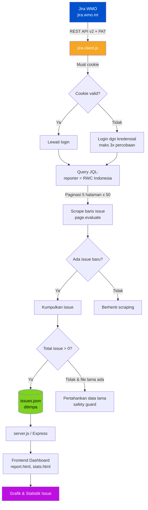
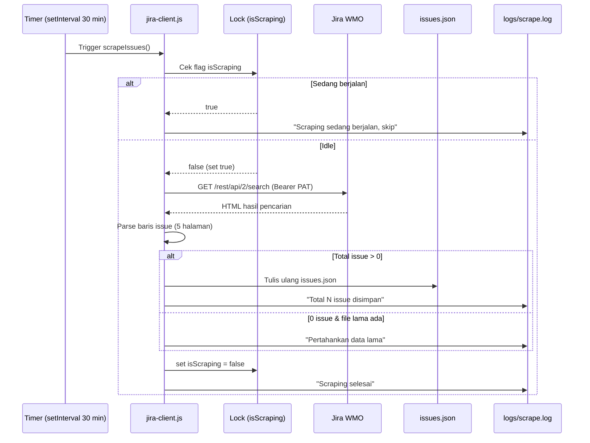
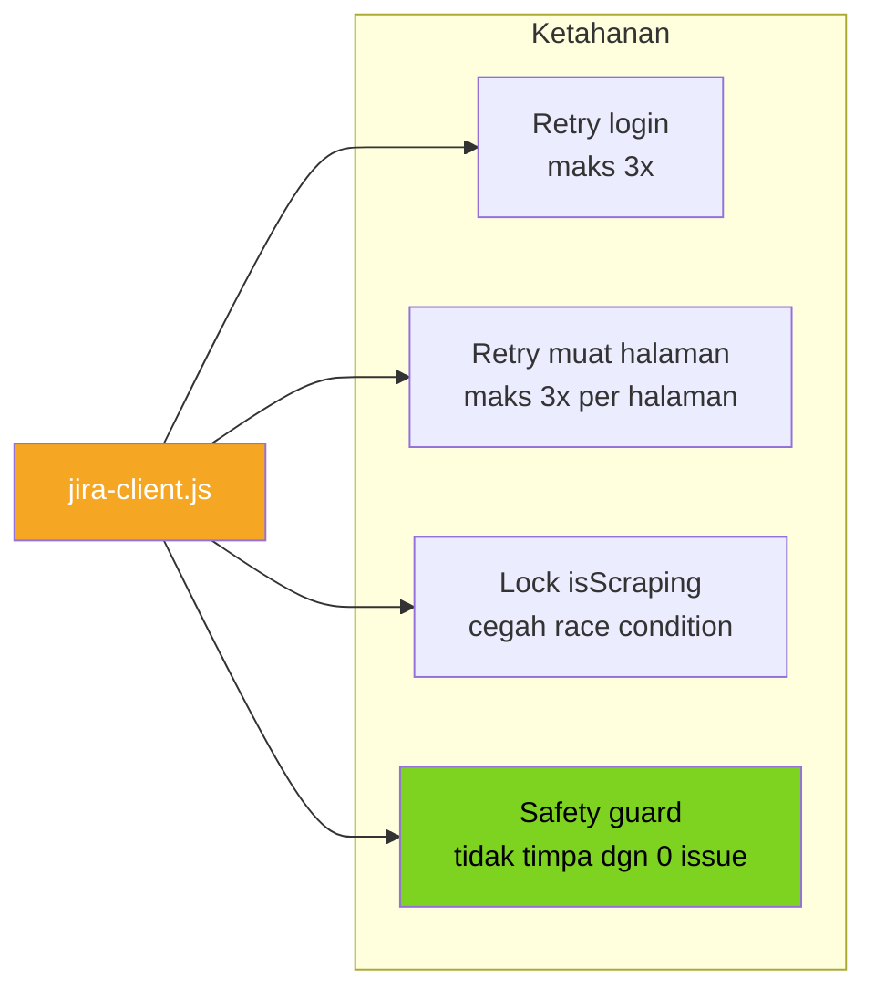
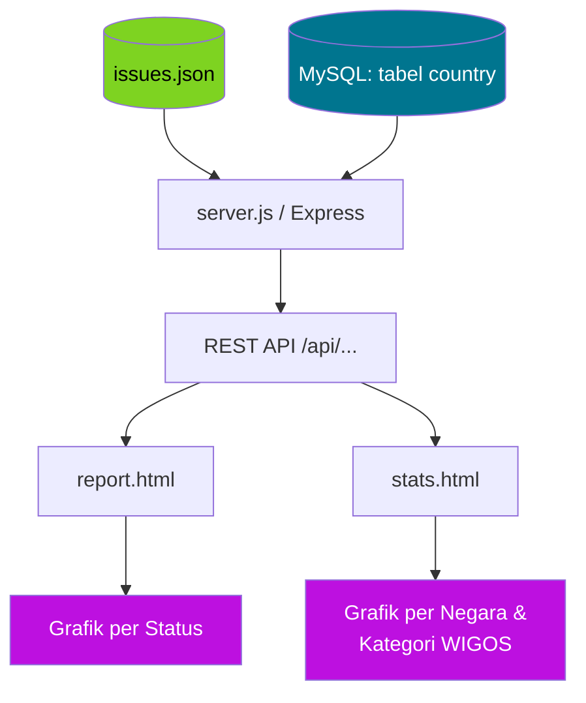
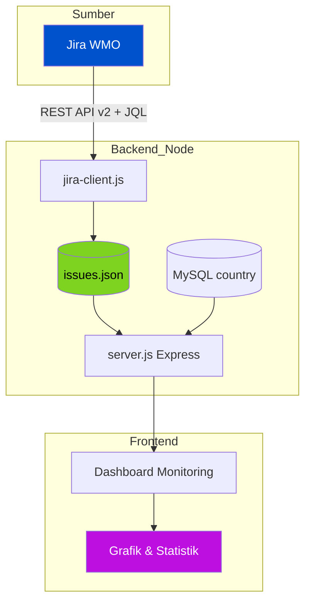

# Alur Data Masuk Sistem — Jira Monitoring

Dokumen ini menjelaskan bagaimana data tiket/issue dari **Jira WMO** masuk ke sistem RWC Indonesia melalui *scraping*, disimpan, dan disajikan di dashboard monitoring.

---

## 1. Ringkasan Sistem

Jira Monitoring adalah modul berbasis **Node.js** (`/server`) yang mengambil data issue yang dilaporkan oleh "RWC Indonesia" di Jira WMO, lalu menyajikannya sebagai laporan dan statistik.

| Komponen | Teknologi | Lokasi |
|----------|-----------|--------|
| Sumber data | Jira WMO | `https://jira.wmo.int` |
| Jira client | Node.js + REST API v2 (Personal Access Token) | `server/jira-client.js` |
| Penyimpanan issue | File JSON | `issues.json` |
| Database referensi | MySQL | DB `jira`, tabel `country` |
| Web server / API | Node.js (Express) | `server/server.js` |
| Frontend | HTML/JS | `public/`, `server/public/` |

---

## 2. Sumber Data

`jira-client.js` memanggil **Jira REST API v2** dengan Personal Access Token, lalu menjalankan query JQL:

```
reporter in ("RWC Indonesia") ORDER BY created DESC
```

Data diambil dengan **paginasi** (5 halaman × 50 issue) dari URL:

```
https://jira.wmo.int/issues/?jql={JQL}&startIndex={0,50,100,...}
```

Field yang di-*scrape* per issue:
- `key`, `summary`, `status`, `assignee`, `reporter`
- `priority`, `created`, `updated`
- `description`, `wigosIssueCategory`, `wigosId`

---

## 3. Diagram Alur Data Utama



---

## 4. Siklus Scraping Terjadwal

Scraper berjalan otomatis dengan `setInterval` (default tiap 30 menit) dan dijaga oleh proses manager (PM2). *Flag* `isScraping` mencegah eksekusi ganda.



---

## 5. Mekanisme Keamanan & Ketahanan Data



> **Catatan keamanan:** Scraper memakai Personal Access Token Jira dari environment variable `JIRA_API_TOKEN` (header `Authorization: Bearer`). Login SSO dengan username/password sudah tidak dipakai. Token disimpan di `.env` yang di-*gitignore* dan sebaiknya dirotasi berkala.

---

## 6. Penyimpanan & Penyajian

- **`issues.json`** — sumber utama data issue yang dibaca oleh `server.js`.
- **MySQL DB `jira`** — tabel `country` sebagai referensi pemetaan negara (Brunei, Indonesia, Malaysia, PNG, Philippines, Singapore, Timor-Leste, US).
- **Frontend** menyajikan: daftar issue, statistik per status (OPEN/CLOSED), kategori WIGOS, distribusi per negara, dan grafik.



---

## 7. Ringkasan End-to-End



---

*Dokumen dibuat berdasarkan analisis kode: `server/jira-client.js`, `server/config/database.js`, `jira.sql`, dan `issues.json`.*
