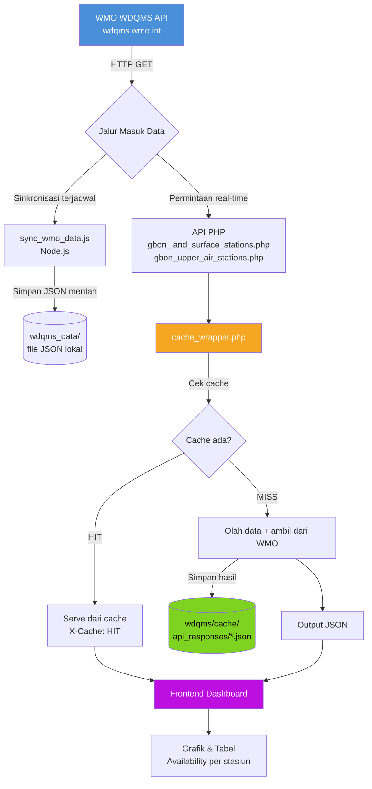
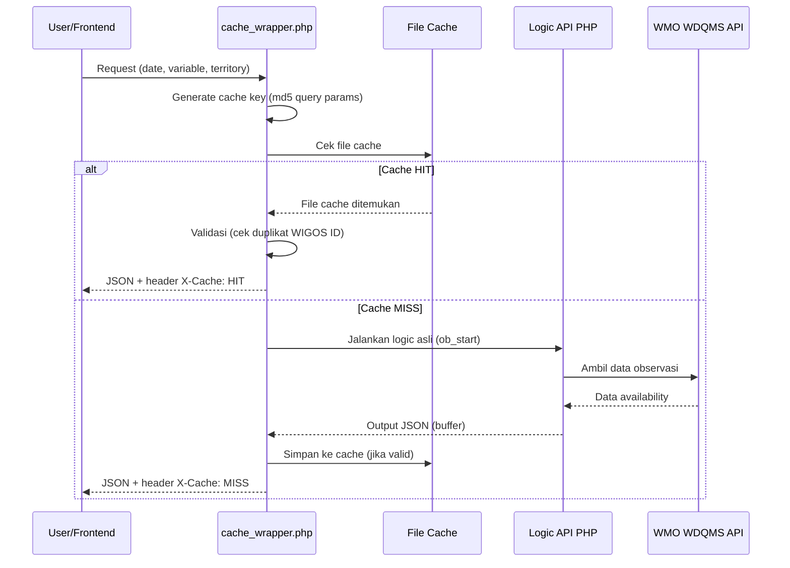
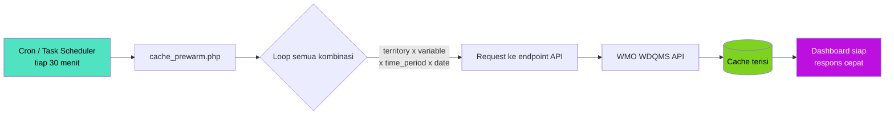
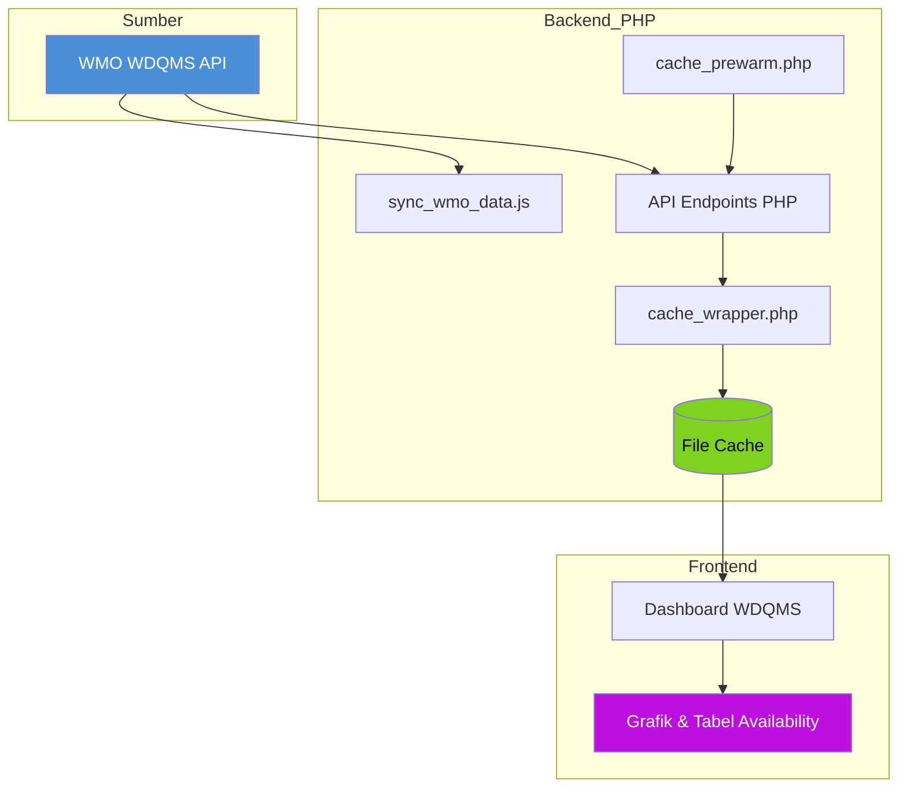

# Alur Data Masuk Sistem — WDQMS Monitoring

Dokumen ini menjelaskan bagaimana data observasi cuaca dari **WMO WDQMS (WIGOS Data Quality Monitoring System)** masuk, diproses, di-*cache*, dan disajikan di dashboard RWC Indonesia.

---

## 1. Ringkasan Sistem

WDQMS Monitoring adalah modul berbasis **PHP** (`/wdqms`) yang menampilkan ketersediaan (*availability*) data observasi stasiun terhadap pusat NWP global (DWD, ECMWF, JMA, NCEP).

| Komponen | Teknologi | Lokasi |
|----------|-----------|--------|
| Sumber data | WMO WDQMS API | `https://wdqms.wmo.int/wdqmsapi/v1/...` |
| Sinkronisasi data | Node.js | `scripts/sync_wmo_data.js` |
| API endpoint | PHP | `wdqms/api/*.php` |
| Caching layer | PHP file cache | `wdqms/cache/api_responses/` |
| Pre-warm cache | PHP CLI + cron | `wdqms/api/cache_prewarm.php` |
| Frontend | HTML/JS | `wdqms/*.php`, `wdqms/reports/` |

---

## 2. Sumber Data

Data diambil dari WMO WDQMS API dengan parameter:

- **Period**: `six_hour`, `daily`, `monthly`
- **Time period**: `00`, `06`, `12`, `18` (UTC synoptic hours)
- **Variable**: `pressure`, `temperature`, `zonal_wind`, `meridional_wind`, `humidity`
- **Centers**: `DWD, ECMWF, JMA, NCEP`
- **Territory**: `ALL_COMBINED`, `IDN`, `MYS`, `SGP`, `PHL`, `BRN`, `TLS`, `PNG`, `USA_PACIFIC`

Contoh URL request:

```
https://wdqms.wmo.int/wdqmsapi/v1/download/gbon/synop/{period}/availability/
    ?date={date}&period={time_period}&variable={variable}&centers=DWD,ECMWF,JMA,NCEP
```

---

## 3. Diagram Alur Data Utama



---

## 4. Mekanisme Caching

`cache_wrapper.php` di-*include* di bagian atas setiap endpoint API. Alurnya:



Karakteristik cache:
- **Permanen** (tidak expired otomatis) — di-*refresh* lewat pre-warm.
- **Cache key** = nama_script + `md5(query_params terurut)`.
- Hanya respons JSON valid dengan field `stations` (tanpa `error`) yang di-cache.
- Cache yang mengandung **duplikat WIGOS ID** otomatis dihapus.

---

## 5. Pre-warming Cache (Terjadwal)

`cache_prewarm.php` dijalankan via cron/Task Scheduler (mis. tiap 30 menit) untuk mengisi cache semua kombinasi parameter, sehingga semua user mendapat *loading* instan.



Default tanggal pre-warm: **2 hari sebelum hari ini** (mengikuti keterlambatan publikasi data WMO).

---

## 6. Penyajian di Dashboard

Data availability yang sudah diolah disajikan sebagai:
- **Tabel stasiun** dengan status ketersediaan per variabel.
- **Time series** ketersediaan (`*_timeseries.php`).
- **Laporan tahunan** (`*_yearly*.php`) dengan cache terpisah.
- **Grafik** perbandingan antar pusat NWP.

---

## 7. Ringkasan End-to-End



---

*Dokumen dibuat berdasarkan analisis kode: `scripts/sync_wmo_data.js`, `wdqms/api/cache_wrapper.php`, `wdqms/api/cache_prewarm.php`, dan `wdqms/config/config.php`.*
