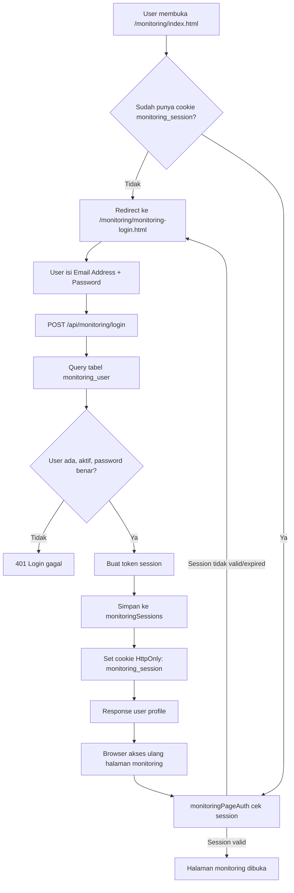
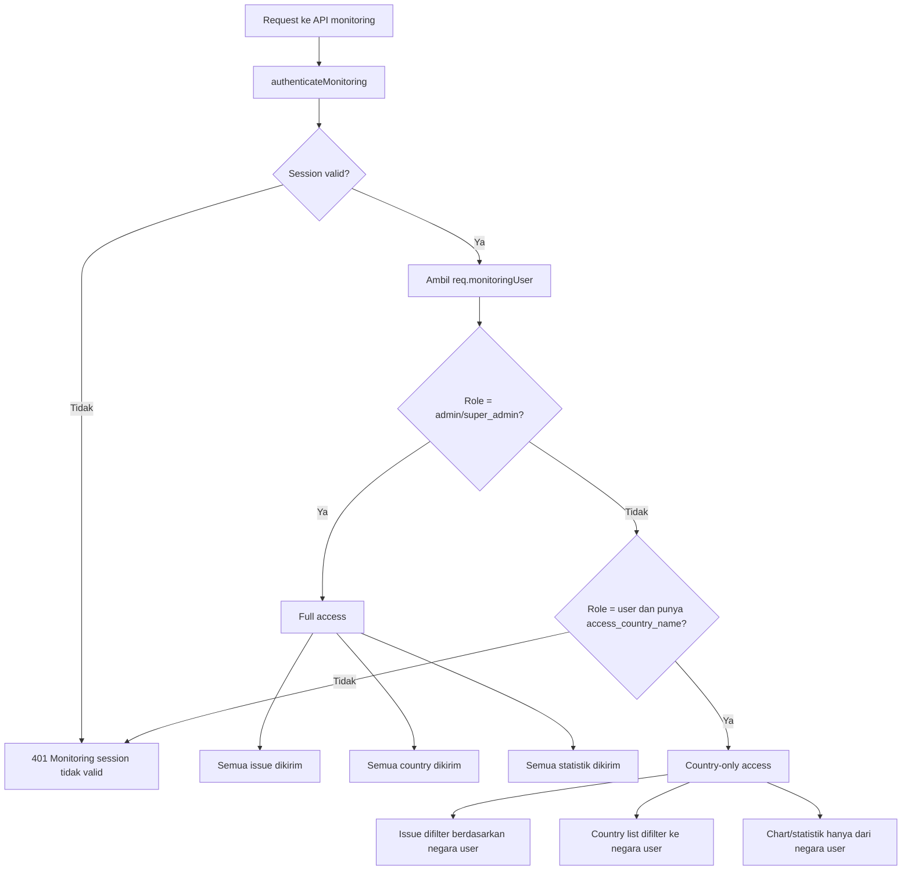
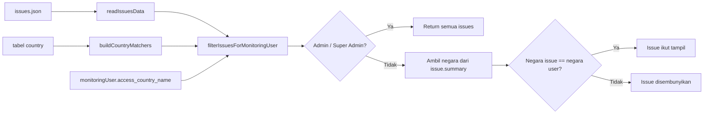

# Monitoring Login Access Diagram

Dokumen ini menjelaskan alur login dan kontrol akses pada modul monitoring Jira RWC Indonesia.

## 1. Authentication Flow



## 2. Authorization Flow



## 3. Issue Filtering Logic



## 4. Role Matrix

| Role | Akses Halaman Monitoring | Akses Semua Negara | Akses Negara Tertentu | Kelola User |
| --- | --- | --- | --- | --- |
| `super_admin` | Ya | Ya | Ya | Ya |
| `admin` | Ya | Ya | Ya | Tidak |
| `user` | Ya | Tidak | Ya, sesuai `access_country_name` | Tidak |

## 5. Session Characteristics

- Session monitoring disimpan di memory server (`monitoringSessions`), bukan Redis/database session store.
- Masa berlaku session: 24 jam.
- Cookie yang dipakai: `monitoring_session`.
- Cookie diset sebagai `HttpOnly` dan `SameSite=Lax`.
- Jika service restart, semua session monitoring akan hilang dan user harus login ulang.

## 6. User Provisioning

```mermaid
flowchart TD
    A[Server start] --> B[initializeMonitoringUsers]
    B --> C[Pastikan tabel monitoring_user ada]
    C --> D[Seed privileged users]
    D --> E[superadmin@rwc.local]
    D --> F[rwc.indonesia@rwc.local]
    D --> G[wmo.secretariat@rwc.local]
    D --> H[wmo.centre@rwc.local]
    C --> I[Ambil daftar negara dari tabel country]
    I --> J[Buat akun NFP per negara]
    J --> K[Format: nfp.slug-negara@rwc.local]
    J --> L[Role: user]
    J --> M[access_country_name + access_country_code diisi]
```

## 7. Endpoint Mapping

- Login monitoring: `POST /api/monitoring/login`
- Cek session monitoring: `GET /api/monitoring/session`
- Logout monitoring: `POST /api/monitoring/logout`
- Issue list: `GET /api/issues`
- Summary ticket: `GET /api/summary`
- Country filter list: `GET /api/countries`
- Country statistics: `GET /api/stats/countries`
- Country + status statistics: `GET /api/stats/countries-status`

## 8. Source References

Implementasi utama ada di:

- `server/server.js`
  - session + cookie monitoring
  - login/logout monitoring
  - middleware proteksi halaman monitoring
  - filter akses `full access` vs `country-only`
  - seed user monitoring

